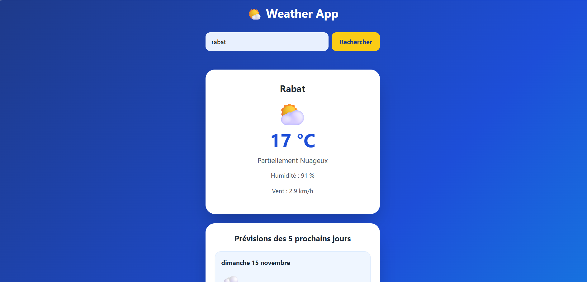
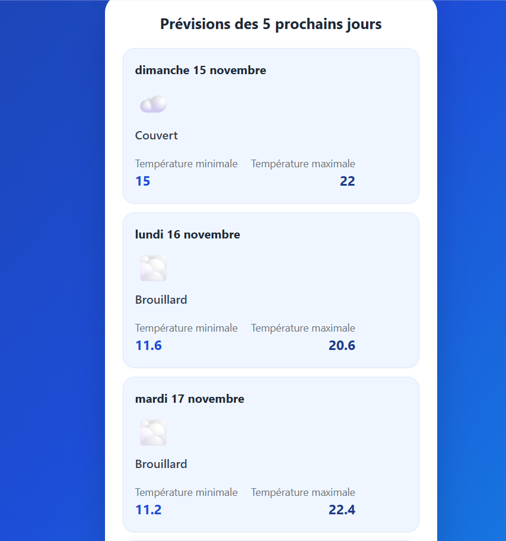
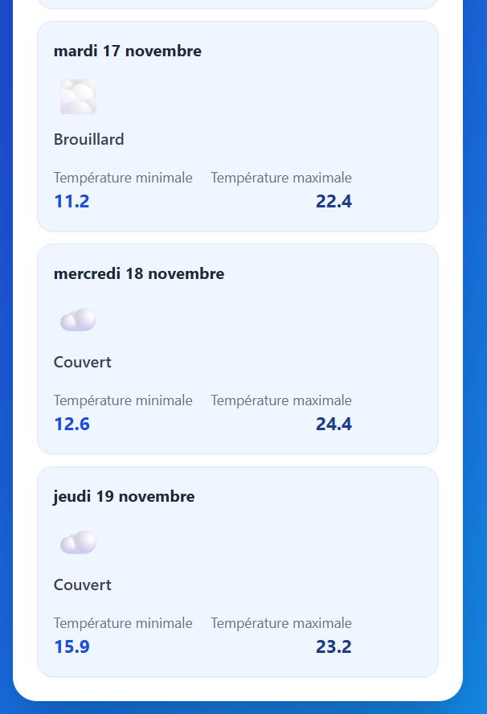

# 🌤️ Weather App

## 📌 Présentation du projet

Weather App est une application web qui permet aux utilisateurs de rechercher une ville et de consulter ses conditions météorologiques actuelles ainsi que les prévisions des cinq prochains jours.

L'application utilise l'API **Open-Meteo** pour récupérer les informations météorologiques et JavaScript pour traiter et afficher les données.

## ✨ Fonctionnalités

- Rechercher une ville.
- Afficher la température actuelle.
- Afficher la description et l'icône météo.
- Consulter les prévisions sur cinq jours.
- Afficher les températures minimales et maximales.
- Gérer les erreurs et proposer une nouvelle tentative.


## 🖼️ Captures d'écran

### 1. Recherche et météo actuelle


### 2. Détails météorologiques


### 3. Prévisions météorologiques sur 5 jours


## 🛠️ Technologies utilisées

- HTML5
- JavaScript
- Tailwind CSS
- Open-Meteo API

## 🚀 Installation et lancement

1. Télécharger ou cloner le projet.
2. Ouvrir le dossier du projet dans Visual Studio Code.
3. Ouvrir le fichier `index.html` dans un navigateur ou utiliser l'extension Live Server de VS Code.

Aucune installation de dépendance n'est nécessaire.

## 📁 Structure du projet

```text
weather-app/
├── index.html
├── main.js
├── README.md
|
└── docs/
    └── journal-de-test.md
```

## 🔗 Endpoints utilisés

L'application utilise deux endpoints de l'API Open-Meteo.

### 1. Geocoding API

**Adresse :** `https://geocoding-api.open-meteo.com/v1/search`

Cet endpoint permet de rechercher une ville et de récupérer ses coordonnées géographiques.

| Paramètre | Description |
|---|---|
| `name` | Nom de la ville recherchée |
| `count=1` | Retourner un seul résultat |
| `language=fr` | Langue française |
| `format=json` | Format de réponse JSON |

### 2. Weather Forecast API

**Adresse :** `https://api.open-meteo.com/v1/forecast`

Cet endpoint permet de récupérer les conditions météorologiques actuelles et les prévisions sur cinq jours.

| Paramètre | Description |
|---|---|
| `latitude` | Latitude de la ville |
| `longitude` | Longitude de la ville |
| `current` | Température, humidité, vitesse du vent et code météo |
| `timezone=auto` | Détection automatique du fuseau horaire |
| `daily` | Code météo et températures minimales et maximales |
| `forecast_days=5` | Prévisions sur cinq jours |

## ⚠️ Limites de l'API et gestion des requêtes

Open-Meteo propose une API gratuite pour les projets non commerciaux, sans clé API.

Les limites d'utilisation gratuite sont :
- 600 requêtes par minute.
- 5 000 requêtes par heure.
- 10 000 requêtes par jour.

Pour respecter ces limites, l'application effectue les requêtes lorsqu'un utilisateur recherche une ville.

En cas de dépassement de la limite, l'API peut retourner le code HTTP `429`. L'application détecte cette réponse et affiche le message : « Limite de requêtes atteinte ».

Les données météorologiques dépendent également de leur disponibilité et des modèles météorologiques utilisés.

**Attribution :** Les données météorologiques sont fournies par [Open-Meteo](https://open-meteo.com/) sous licence CC BY 4.0.

### Disponibilité et limites des données météorologiques

- Les données météorologiques proviennent de modèles de prévision numérique qui sont généralement mis à jour toutes les quelques heures.
- Les données disponibles et leur résolution peuvent varier selon la localisation géographique et le modèle météorologique utilisé.
- Certaines variables météorologiques peuvent ne pas être disponibles pour toutes les régions.
- Les conditions météorologiques affichées sont des estimations issues de modèles et ne représentent pas nécessairement des mesures en temps réel.
- Open-Meteo ne garantit pas l'exactitude, l'exhaustivité ni la disponibilité continue des données.

**Dans notre application :**
- Nous affichons les conditions météorologiques actuelles fournies par l'API.
- Nous limitons les prévisions à 5 jours grâce au paramètre `forecast_days=5`.
- En cas d'indisponibilité du service, l'application affiche un message d'erreur à l'utilisateur.


## 📊 Exemple de réponse JSON et affichage des données

L'API Open-Meteo retourne une réponse au format JSON contenant les informations météorologiques actuelles et les prévisions quotidiennes.

### 1. Exemple de réponse JSON (résumé)

```json
{
  "latitude": 35.14821,
  "longitude": -2.9078448,
  "timezone": "Africa/Casablanca",
  "current": {
    "temperature_2m": 15.7,
    "relative_humidity_2m": 95,
    "wind_speed_10m": 6.5,
    "weather_code": "..."
  },
  "daily": {
    "time": ["..."],
    "weather_code": ["..."],
    "temperature_2m_max": ["..."],
    "temperature_2m_min": ["..."]
  }
}
```

### 2. Affichage des données

| Donnée JSON | Utilisation dans l'application |
|---|---|
| `current.temperature_2m` | Affichage de la température actuelle en °C |
| `current.relative_humidity_2m` | Affichage du taux d'humidité en % |
| `current.wind_speed_10m` | Affichage de la vitesse du vent en km/h |
| `current.weather_code` | Détermination de la description et de l'icône météo |
| `daily.time` | Affichage de la date de chaque prévision |
| `daily.weather_code` | Affichage de l'icône et de la description météo |
| `daily.temperature_2m_max` | Affichage de la température maximale |
| `daily.temperature_2m_min` | Affichage de la température minimale |

Les codes météo sont associés à des descriptions et des icônes grâce à l'objet JavaScript `WEATHER_CODES`.

Les données quotidiennes sont transformées avec la méthode `map()` en objets JavaScript, puis affichées sous forme de cartes HTML grâce à `innerHTML`.


### 🔐 Configuration de l'API

L'application utilise l'API Open-Meteo, qui ne nécessite aucune clé API pour une utilisation gratuite non commerciale.

Aucune clé API ni variable secrète n'est nécessaire pour lancer le projet.